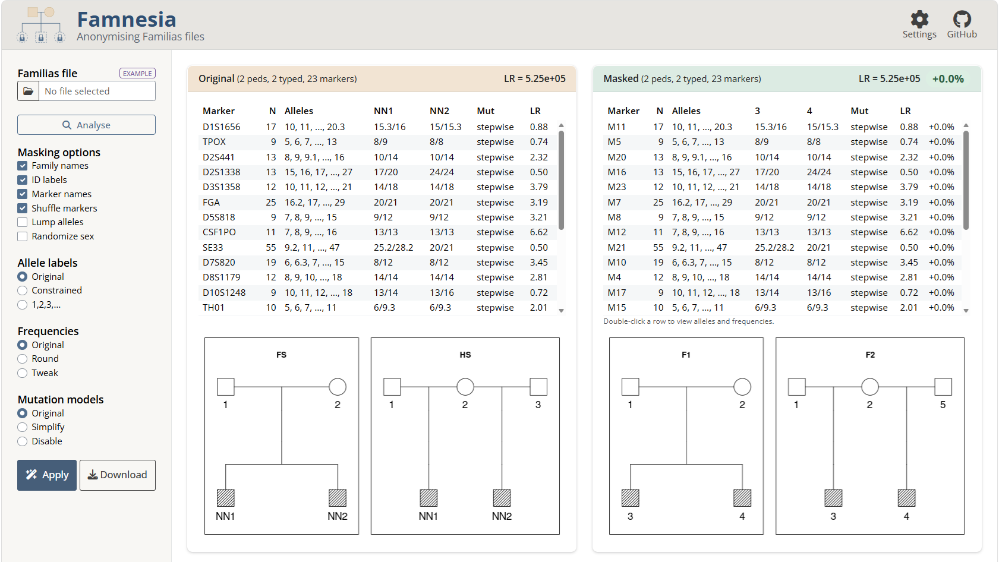

```{r setup, include=FALSE}
knitr::opts_chunk$set(echo = FALSE, 
                      fig.align = "center",
                      dpi = 300,
                      collapse = TRUE,
                      comment = "#>")
```

<!-- avoid border around images -->
<style>
    img {border: 0;}
</style>

```{r square, out.width = "99%"}

```

<br>

::: { .greeting .message style="color: red; font-size: large;"}
**_Source code here_**: https://github.com/magnusdv/famnesia.
:::

<br>

## What is Famnesia?

Famnesia is a Shiny app for anonymising files from Familias, a program for kinship calculations in forensic genetics. Its aim is to enable safer sharing of sensitive data, for instance for:

* collaborative work and research
* troubleshooting and software support
* teaching and demonstrations
* reproducible examples and testing

More information is available in the GitHub repository: https://github.com/magnusdv/famnesia.
